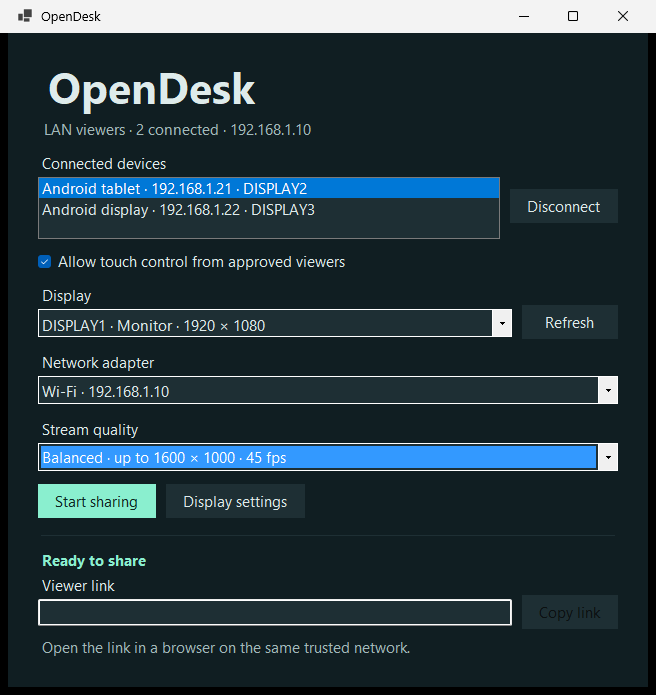

# OpenDesk

**Turn Android devices into wireless Windows displays.**

   

OpenDesk extends your Windows desktop to Android devices over your local network. It is free, open source, and works without an account or cloud service. The Windows host uses the separately installed open-source Virtual Display Driver to create up to two independent displays.

## Downloads

Get **OpenDesk-0.6.0-win-x64.zip** and **OpenDesk-Viewer-0.5.0.apk** from [Releases](https://github.com/Lostepic/OpenDesk/releases). The Windows download is self-contained. Version numbers differ because the Android viewer and host are released independently.

## Features

- Discover a Windows PC on the local network or enter its IP address.
- Extend Windows to two Android devices, with display positions remembered between connections.
- Reconnect approved viewers automatically while their app is open.
- Use tap, drag and multi-touch gestures in compatible Windows applications.
- Adjust streaming quality on the host while viewers are connected.
- Share a selected display with a browser using a session link.

## Screenshots

The Windows host shows connected viewers, display selection and streaming quality. Addresses and device names in these screenshots are examples.




## Getting started

1. On Windows 10 or 11, install the signed [Virtual Display Driver](https://github.com/VirtualDrivers/Virtual-Display-Driver) and configure a virtual monitor for each viewer. Add the Android device’s native resolution to its driver configuration when needed.
2. Extract the Windows ZIP and open **OpenDesk.exe**. Select the network adapter connected to your devices.
3. Install the APK on each Android 6.0 or later device with a working Android System WebView. Open **OpenDesk Viewer**, select your PC, and approve the initial connection on Windows.
4. Arrange the new screens in Windows Display Settings. OpenDesk remembers the positions. Touch **Show controls** to reveal viewer controls in full-screen mode.

The host and viewers need to be on the same local subnet. Allow the host on a Private Windows network for UDP 47825 and TCP 47825–47827. Browser sharing uses TCP 47824. Video, session credentials and touch input use unencrypted HTTP and WebSocket connections, so use a trusted network. Approved viewers can control Windows while touch control is enabled. Keep your Android app signing key private when building your own updates.

## Build

Install the [.NET 10 SDK](https://dotnet.microsoft.com/download/dotnet/10.0) and build the Windows host on Windows:

```powershell
dotnet publish .\OpenDesk.csproj -c Release -r win-x64 --self-contained true -p:PublishSingleFile=true -p:IncludeNativeLibrariesForSelfExtract=true -p:EnableCompressionInSingleFile=true -p:DebugType=None -o .\dist\win-x64
```

For Android, install a JDK, Android 35 platform and Build Tools 35.0.0. Create a PKCS#12 signing key with alias `opendesk-viewer`, set `OPENDESK_SIGNING_PASSWORD` in your shell and run:

```powershell
.\Android\build.ps1 -PlatformJar "$env:ANDROID_HOME\platforms\android-35\android.jar" -BuildTools "$env:ANDROID_HOME\build-tools\35.0.0" -SigningKey "C:\path\to\opendesk-viewer.p12"
```

Retain the signing key securely to install future builds over existing installations. The app uses JPEG streaming. Frame rates are targets and depend on the PC, network and viewer. Pinch-to-zoom requires support in the Windows application receiving the gesture.

## License

OpenDesk is available under the [MIT License](LICENSE). The separate Virtual Display Driver and .NET runtime have their own licenses. Runtime notices are included in the Windows download.
