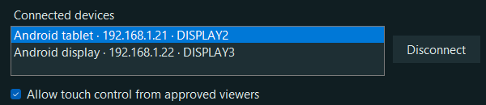

# OpenDesk

**Turn Android devices into wireless Windows displays.**

   

OpenDesk extends your Windows desktop to Android devices over your local network. It is free, open source, and works without an account or cloud service. The Windows host uses the separately installed open-source Virtual Display Driver to create up to two independent displays.

## Why OpenDesk?

I wanted to extend my Windows desktop onto my Echo Show devices, which I had flashed with Android, and use them as external displays. The other solutions I found were paid or offered only a free trial, so I built OpenDesk with the help of AI.

## Downloads

Get **OpenDesk-0.7.2-win-x64.zip** and **OpenDesk-Viewer-0.7.1.apk** from [Releases](https://github.com/Lostepic/OpenDesk/releases). The Windows download is self-contained. The Windows 0.7.2 host and Android 0.7.1 viewer are compatible. Update both when upgrading from releases older than 0.7.0.

## Features

- Discover a Windows PC on the local network or enter its IP address.
- Extend Windows to two Android devices, with display positions remembered between connections.
- Reconnect approved viewers automatically while their app is open.
- Use tap, drag and multi-touch gestures in compatible Windows applications.
- Adjust streaming quality on the host while viewers are connected.
- Share a selected display with a browser using a session link.

## Screenshots

The Windows host shows connected viewers, display selection and streaming quality. Addresses and device names in these screenshots are examples.




## Getting started

1. Install the signed Virtual Display Driver and configure one virtual monitor per Android viewer. See [Virtual Display Driver](#virtual-display-driver) for the recommended build and setup.
2. Extract the Windows ZIP and open **OpenDesk.exe**. Select the network adapter connected to your devices.
3. Install the viewer APK on Android 8.0 or later with Android System WebView. Open **OpenDesk Viewer**, select your PC, and compare the code shown under **Pair Android viewer** on Windows and tap **Code matches** on Android. Approve each device on Windows. Devices approved on older versions need to pair again.
4. Arrange the new screens in Windows Display Settings. OpenDesk remembers the positions. Touch **Show controls** to reveal viewer controls in full-screen mode.

The host and viewers need to be on the same local subnet. Allow the host on a Private Windows network for UDP 47825 and TCP 47825–47827. Browser sharing uses TCP 47824. Starting with the 0.7 series, pairing credentials, video and touch use TLS. The Android app verifies the host certificate against the certificate saved during pairing. Verify the same fingerprint before accepting the self-signed certificate in a browser. Discovery uses UDP to advertise the host and port. Earlier releases use unencrypted transport. Approved viewers can control Windows while touch control is enabled. Keep your Android app signing key private when building your own updates.

## Virtual Display Driver

For two extended displays, use a signed driver build that includes [the upstream multi-monitor swapchain fix](https://github.com/VirtualDrivers/Virtual-Display-Driver/pull/482). The upstream 25.7.23 release predates that fix and can cause stutter on physical monitors while two virtual displays are active, even when OpenDesk is closed.

The tested build is **26.9.19.60 x64** from upstream commit `68043d9`. With two Echo Shows streaming, the longest measured frame interval in a repeatable bottom-edge window drag fell from 558 ms to 23 ms after updating the driver. [Upstream build and artifacts](https://github.com/VirtualDrivers/Virtual-Display-Driver/actions/runs/35440900023)

- For a first install, use the upstream [Virtual Display Driver setup instructions](https://github.com/VirtualDrivers/Virtual-Display-Driver) to create the Windows device. Configure one virtual monitor per viewer and add each panel's native resolution if it is missing. The Echo Show 8 uses 1280 × 800 and the Echo Show 5 tested here uses 960 × 480.
- For an existing installation, sign in to GitHub and download **VDD-x64-Release-signed** from the upstream build. GitHub lists 18 December 2026 as the artifact's expiry date. After it expires, use a newer signed package once the maintainers publish one that includes the fix.
- The SHA-256 of the tested GitHub artifact ZIP is `e4ab035d559ee24026c30413fcf008ee8f32d607764b277c25d560b0d0782c8e`. Check it with `Get-FileHash` and verify that the extracted `MttVDD.cat` has a valid **SignPath Foundation** signature. Update the existing driver from the extracted package with the command below in an administrator PowerShell window. Windows may briefly reset the displays.

```powershell
pnputil /add-driver .\MttVDD.inf /install
```

### Start OpenDesk at sign-in

Keep the Windows build in a permanent folder. Press **Win+R**, enter `shell:startup`, and add a shortcut to `OpenDesk.exe` in the folder that opens. After Windows sign-in, approved Shows reconnect automatically while OpenDesk Viewer is open.

## Build

The current Windows source targets Windows 10 version 2004 or later. Install the [.NET 10 SDK](https://dotnet.microsoft.com/download/dotnet/10.0) and build the host on Windows:

```powershell
dotnet publish .\Windows\OpenDesk.csproj -c Release -r win-x64 --self-contained true -p:PublishSingleFile=true -p:IncludeNativeLibrariesForSelfExtract=true -p:EnableCompressionInSingleFile=true -p:DebugType=None -o .\dist\win-x64
```

`Windows/` contains the host and browser viewer. `Android/` contains the native viewer. `docs/images/` contains the README screenshots.

For Android, install a JDK, Android 35 platform and Build Tools 35.0.0. Create a PKCS#12 signing key with alias `opendesk-viewer`, set `OPENDESK_SIGNING_PASSWORD` in your shell and run:

```powershell
.\Android\build.ps1 -PlatformJar "$env:ANDROID_HOME\platforms\android-35\android.jar" -BuildTools "$env:ANDROID_HOME\build-tools\35.0.0" -SigningKey "C:\path\to\opendesk-viewer.p12"
```

Retain the signing key securely to install future builds over existing installations. The app uses JPEG streaming. Frame rates are targets and depend on the PC, network and viewer. Pinch-to-zoom requires support in the Windows application receiving the gesture.

## AI and contributions

OpenDesk was made with the help of AI and is provided without guarantees or warranty. Pull requests, fixes, improvements and other contributions are welcome.

## License

OpenDesk is available under the [MIT License](LICENSE). The separate Virtual Display Driver and .NET runtime have their own licenses. Runtime notices are included in the Windows download.
